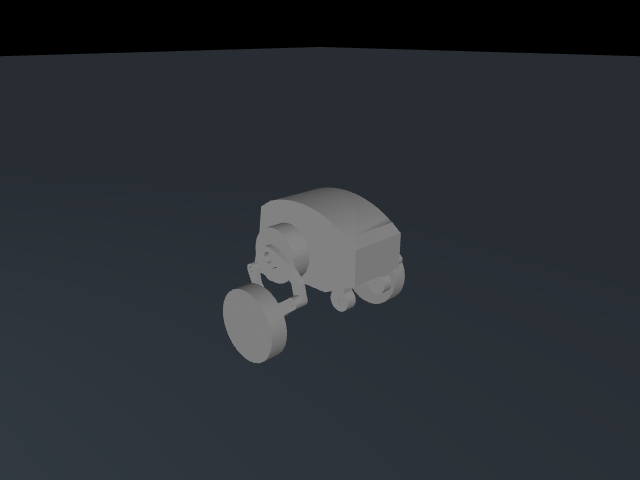

# 具身执行 · 刑天 DIABLO GPU 运动训练

面向刑天 DIABLO 双轮足机器人的 MJLab 分阶段运动学习工程。训练使用 MuJoCo Warp 在 NVIDIA GPU 上并行仿真，并通过 RSL-RL PPO 更新策略；CPU MuJoCo 环境只用于机构、传感器和状态机回归。



## 项目功能

- 从公开 CAD 和 Webots 机构构建六主动关节、四被动关节及两个平行四边形闭环。
- 保留六个电机、IMU、轮地接触和地形射线感知；机器人质量、惯量和几何采用原始主分支的 CAD 基线 `21.019506 kg`，不缩放成官网整机质量。
- 默认健康站姿在轮底接地时为 `477.859 mm`，基座目标 `0.350 m`，复位保留 `5 mm` 离地间隙；`491 mm` 继续作为产品上部包络元数据。
- 提供默认速度/地形课程、7 个独立转向阶段和 1 个二维自适应速度扩展阶段；行驶转向上限统一为 `1.2 rad/s`。
- 使用无外部记忆状态的时序残差 Actor-Critic：五帧分组编码、因果卷积、指令 FiLM、髋膝/轮速双输出头和解析轮速前馈。
- 奖励和 gate 直接读取任务课程 JSON，包括速度、方向性偏航欠速/超速、累计转角、航向保持漂移、目标路径法向速度、转向轮中心偏移、高度、姿态、启停、稳态/瞬态轮滑、轮同步、后滑和障碍事件。
- yaw 目标在所有阶段叠加有界 heading-error 闭环修正；原地转向训练混入独立评估的前进/后退排练，且不改变原转向 gate。
- 轮心偏移超过训练容差后持续增加惩罚，并分别记录左右髋膝相对姿态差与逐转向方向的轮心偏移。
- 最终综合阶段从全部周期 checkpoint 中执行 3 种子初筛、5 个新种子复筛，并保存 `policy-best.pt` / `policy-best.onnx`。
- 保留 CPU 机构校核；旧单线程训练、评估、续训和示例路径已移除。

## 环境要求

- Linux x86_64
- Python 3.11 或 3.12
- NVIDIA GPU 和与所选 PyTorch CUDA wheel 兼容的驱动
- Git 和能够访问模型原始仓库、PyPI、PyTorch 下载站的网络

## 安装与检查

```bash
git clone https://github.com/KylinGR/embodied-execution.git
cd embodied-execution
bash scripts/setup.sh
source .venv/bin/activate
```

安装流程会获取固定提交的机器人模型与 Webots 机构资源，然后执行：

```bash
diablo doctor
diablo gpu-doctor
diablo list-stages --n-envs 4096
```

`doctor` 验证 CPU 机构模型；`gpu-doctor` 验证 CUDA、MuJoCo Warp、MJLab、观测形状和一次 GPU 物理步。缺少 CUDA 时程序会明确失败，不会静默使用 CPU 训练。

训练命令的 `--gpu-ids` 使用物理 GPU 编号，并在导入 CUDA 前设置 `CUDA_VISIBLE_DEVICES`。例如 `--gpu-ids 2` 会训练物理 GPU 2，但训练子进程收到的本地编号是 `0`；同一课程后续的 `--device` 使用遮蔽后的本地编号。

## 分阶段训练

运行完整课程：

```bash
diablo course-train \
  --n-envs 4096 \
  --gpu-ids 0 \
  --log-root logs/rsl_rl
```

每个前置阶段完成后，脚本会用验证种子 `2001–2003` 检查最后一个 checkpoint。只有全部 profile 和全部 gate 都通过，才把该权重作为下一阶段的初始化参数。默认总课程预算与迭代数由 JSON 中的预算自动计算。

从 080 平地策略运行独立转向主干课程：

```bash
diablo list-stages --course turning --n-envs 4096
diablo course-train \
  --course turning \
  --warm-start logs/rsl_rl/diablo_xingtian_course/<080-run>/model_0.pt \
  --critic-calibration-steps 98304 \
  --n-envs 4096 \
  --gpu-ids 0 \
  --log-root logs/rsl_rl
```

原地转向从最低 0.4 rad/s 开始，角速度变化固定为 2 秒并保持目标 10 秒。直线行驶使用 4 秒加速和 4 秒减速；行驶转弯保持 1.2 rad/s 上限，且所有组合都校验安全转弯半径。

轮速前馈入口会把偏航指令硬限制在 `±2.0 rad/s`。转向课程的终止倾角不随角速度放宽，正常滚转由奖励、`max_roll_deg` gate 和独立日志共同约束。

需要复习旧技能并把直行速度扩展到 `1.0 m/s` 时，使用自适应课程：

```bash
diablo list-stages --course adaptive --n-envs 4096
diablo train \
  --stage flat_adaptive_speed \
  --warm-start logs/rsl_rl/diablo_xingtian_course/<moving080-run>/model_720.pt \
  --initial-std 0.05 \
  --critic-calibration-steps 98304 \
  --n-envs 4096 \
  --gpu-ids 0 \
  --log-root logs/rsl_rl
```

`training_objectives.json` 是目标速度、复习上限、角速度上限、时间和转弯半径的唯一人工入口。`flat_adaptive_speed` 从 `0.2 m/s`、`0.4 rad/s` 和 20 秒原地平衡开始复习，按二维网格表现自动扩张；行驶转弯必须满足 `0.667–10 m` 半径并受 `1.2 rad/s` 上限约束。
直行速度和行驶转弯速度使用独立上限：直行为 `1.0 m/s`，行驶转弯为 `0.9 m/s`。`0.9 / 1.2 = 0.75 m`，比最小安全半径多留约 12.5% 的曲率余量。主速度课程会自动截取到对应目标速度。

自适应课程的保护集以 `flat_turn_moving_080/model_720.pt` 的实际能力为上限：平衡、直行到 `0.8 m/s`、原地转向到 `0.8 rad/s`、行驶转弯 `0.4 × 0.4` 和 `0.6 × 0.8`。原地 `1.0/1.2 rad/s`、直行 `1.0 m/s` 以及 `0.8 × 0.8` 行驶转弯均属于候选扩张能力，不冒充保护能力。protected health 只检查持续时间、直立、俯仰、横滚和高度安全；连续两个完整窗口达到 `0.8` 后可用。课程扩张使用连续两个窗口 `0.8` 的核心安全成功率。最终发布仍保持 512 episode、`0.9` 全指标通过率。
`flat_adaptive_speed` 接受任意满足 `temporal_residual_v1` actor 输入输出接口的 checkpoint；protected cell 和核心健康 gate 仍作为参考配置，不限制 warm-start 权重来源。
所有新训练阶段统一使用默认姿态实测的轮中心半轮距 `0.24125 m`；轮速前馈、策略内部 yaw 估计和奖励轮速归一化使用同一几何。转向阶段启用 common residual 限幅 `0.2`。

从可行驶转弯的 `model_720.pt` 继续训练 `0.9 m/s × 1.2 rad/s` 的 S 弯：

```bash
diablo train \
  --stage flat_turn_moving_120 \
  --warm-start logs/rsl_rl/diablo_xingtian_course/<moving_080-run>/model_720.pt \
  --transfer actor \
  --initial-std 0.05 \
  --critic-calibration-steps 98304 \
  --n-envs 4096 \
  --gpu-ids 0
```

warm-start 默认保留源 actor 的探索标准差；示例显式使用较低噪声继续精调。S 弯 gate 使用分方向累计转角、参考 S 轨迹的局部法向误差、平衡姿态、轮滑和轮心偏移，不使用直行横线误差。法向误差不会把沿路径方向的速度滞后误算成弯道形状错误；行驶转弯的轮心容差单独为 `0.045 m`，其他任务仍使用 `0.035 m`。

训练后用同一组检查点执行多 seed 验收：

```bash
diablo evaluate \
  --stage flat_turn_moving_120 \
  --checkpoint <run>/model_<iter>.pt \
  --seeds 2001,2002,2003 \
  --profile-set required \
  --eval-mode exact
```

速度/角速度训练网格仍使用 `0.2` 分辨率；行驶转弯的采样边界可落在 `0.9 m/s` 安全上限，不要求上限本身是网格中心。

自适应阶段另有 PPO 稳定性硬约束：学习率上限 `1e-4`，actor 高斯标准差范围 `[0.05, 0.35]`。
RSL-RL 对该 `std_range` 做的是有效 std 硬截断。监控 `Loss/learning_rate`、`Policy/mean_noise_std` 和 target profile 的 `speed_mae_mps`：若学习率未超限、旧技能仍稳定，但 std 连续多个保存周期贴近 `0.35` 且高速误差不再下降，可新建 run 并将 `std_max` 小幅提高到 `0.40`；若旧技能开始退化，则不要放宽探索，应先降低初始学习率或回退速度前沿。

```bash
diablo show-objectives
diablo validate-config
```

转向课程使用 RSL-RL 自适应学习率，并把转向 run 的学习率硬上限设为 `1e-3`，与同类轮足/足式项目常用的初始学习率对齐；原生自适应上限 `1e-2` 不再允许触发。warm-start 默认保留源 actor 的探索标准差；需要改变探索强度时显式传入 `--initial-std`。熵系数仍为 `0.002`，先隔离验证自适应学习和动作饱和问题，再决定是否提高探索奖励。

单独训练一个阶段：

```bash
diablo train --stage flat_balance --n-envs 4096 --gpu-ids 0
```

新策略可先对 `flat_motion_020` 做约 2M transition 的筛选；在 4096 个环境、
每环境 24 步的默认 rollout 下对应 21 次迭代。筛选通过后再使用阶段默认的 8M
预算完成正式训练。

```bash
diablo train \
  --stage flat_motion_020 \
  --n-envs 4096 \
  --gpu-ids 0 \
  --iterations 21
```

从上一阶段 checkpoint 继续：

```bash
diablo train \
  --stage flat_motion_020 \
  --resume logs/rsl_rl/diablo_xingtian_course/<run>/model_<iter>.pt
```

跨阶段只迁移 actor，并为新阶段创建新的 critic 和优化器：

```bash
diablo train \
  --stage flat_motion_020 \
  --warm-start logs/rsl_rl/diablo_xingtian_course/<run>/bestmodel.pt
```

`--resume` 只比较当前阶段的训练语义，修改其他阶段不会误拦截。`--warm-start` 会新建目标阶段 run；`--transfer actor` 只复制 actor，`--transfer actor-critic` 可同时复制 critic。两者不能同时使用，warm-start 始终重置 optimizer 和迭代。

```bash
diablo train \
  --stage flat_motion_020 \
  --warm-start <010-run>/model_<iter>.pt \
  --transfer actor-critic \
  --initial-std 0.3 \
  --critic-calibration-steps 5000
```

改变模型、奖励或课程配置后，旧 run 不能续训；续训会拒绝源码哈希不一致的 checkpoint。

## 最佳权重筛选

`composite` 阶段默认每 10 次迭代保存一个 checkpoint。单独执行筛选：

```bash
diablo select-best \
  --run-dir logs/rsl_rl/diablo_xingtian_course/<run> \
  --stage composite \
  --device cuda:0
```

筛选规则：

1. 所有 `model_*.pt` 使用 fast 向量模式和多 profile 并行 episode 做种子 `2001` 初筛。
2. 通过初筛者使用 exact 单 profile 配对模式复核种子 `2002–2006`；五个 seed 必须全部通过。
3. 使用完成度 25%、速度/转向 25%、姿态/高度 25%、坡面/障碍 15%、轮滑/效率 10% 的综合 gate 分数排序。
4. 最优 checkpoint 复制为 `policy-best.pt`，并生成 `policy-best.onnx` 和完整 `selection.json`。
5. 选择完成后使用盲测种子 `3101–3110` 和边界种子 `4101–4103` 报告泛化结果，后两类种子不参与选择。

## 评估与导出

```bash
diablo evaluate \
  --stage composite \
  --checkpoint <run>/policy-best.pt \
  --seeds 2001,2002,2003 \
  --eval-mode fast

diablo evaluate \
  --stage flat_adaptive_speed \
  --checkpoint <run>/policy-best.pt \
  --seeds 2001,2002,2003 \
  --profile-set required \
  --eval-mode exact

diablo export \
  --stage composite \
  --checkpoint <run>/policy-best.pt \
  --output runs/export
```

`fast` 模式会在同一 MJLab 向量环境中并行运行不同 profile，可通过 `--eval-envs` 覆盖批量；逐 episode 原始结果只有加 `--write-raw` 才写入 JSON。

Actor 输入为 `float32[B,125]`，由五帧 25 维本体观测组成；输出为 `float32[B,6]` 归一化动作。Actor 在内部把输入还原为五帧序列，使用小型因果卷积和 MLP 生成髋膝与轮速残差。轮速目标由前向/偏航运动学前馈加网络残差构成；地形扫描只进入 Critic。导出的 ONNX 单输入、单输出，是仿真训练接口，不是刑天实机控制器；`hardware_authorized=false`。

## 验证

```bash
bash scripts/check_training.sh
DIABLO_GPU_CHECK=1 bash scripts/check_training.sh
```

第一条执行语法、公开课程、CPU 机构和统计逻辑检查。第二条还执行 GPU smoke、短 PPO、checkpoint 重载和 ONNX 导出。完整 226M transition 训练和使用 blind seeds 通过 gate 是独立的人工验收步骤。

详细说明见 [训练文档](docs/tutorial.md)，模型接口见 [模型契约](docs/model-interface.md)。
