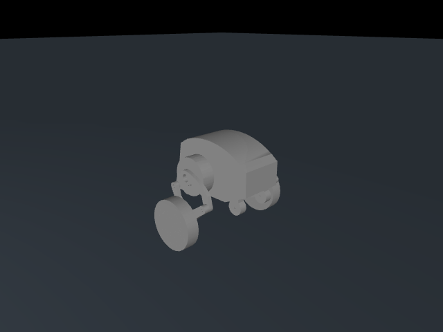

# 具身执行 · 刑天 DIABLO GPU 运动训练

面向刑天 DIABLO 双轮足机器人的 MJLab 分阶段运动学习工程。训练使用 MuJoCo Warp 在 NVIDIA GPU 上并行仿真，并通过 RSL-RL PPO 更新策略；CPU MuJoCo 环境只用于机构、传感器和状态机回归。



## 项目功能

- 从公开 CAD 和 Webots 机构构建六主动关节、四被动关节及两个平行四边形闭环。
- 保留六个电机、IMU、轮地接触和地形射线感知；总质量归一化为官网 22.9 kg。
- 提供 18 个 MJLab 阶段任务：平衡、0.2–2.0 m/s 速度阶梯、平地综合运动、转向、多次启停、35° 坡、崎岖地形、碾压障碍和综合路线。
- 奖励和 gate 直接读取任务课程 JSON，包括速度、偏航、高度、姿态、启停、轮滑、轮同步、后滑和障碍事件。
- 最终综合阶段从全部周期 checkpoint 中执行 3 种子初筛、5 个新种子复筛，并保存 `policy-best.pt` / `policy-best.onnx`。
- 保留 CPU 机构校核；旧单线程训练、评估、续训和示例路径已移除。

## 环境要求

- Linux x86_64
- Python 3.11 或 3.12
- NVIDIA GPU 和与所选 PyTorch CUDA wheel 兼容的驱动
- Git 和能够访问模型原始仓库、PyPI、PyTorch 下载站的网络

## 安装与检查

```bash
git clone https://github.com/KylinGR/embodied-execution.git
cd embodied-execution
bash scripts/setup.sh
source .venv/bin/activate
```

安装流程会获取固定提交的机器人模型与 Webots 机构资源，然后执行：

```bash
diablo doctor
diablo gpu-doctor
diablo list-stages --n-envs 4096
```

`doctor` 验证 CPU 机构模型；`gpu-doctor` 验证 CUDA、MuJoCo Warp、MJLab、观测形状和一次 GPU 物理步。缺少 CUDA 时程序会明确失败，不会静默使用 CPU 训练。

## 分阶段训练

运行完整课程：

```bash
diablo course-train \
  --n-envs 4096 \
  --gpu-ids 0 \
  --log-root logs/rsl_rl
```

每个前置阶段完成后，脚本会用验证种子 `2001–2003` 检查最后一个 checkpoint。只有全部 profile 和全部 gate 都通过，才把该权重作为下一阶段的初始化参数。默认总课程预算与迭代数由 JSON 中的预算自动计算。

单独训练一个阶段：

```bash
diablo train --stage flat_balance --n-envs 4096 --gpu-ids 0
```

从上一阶段 checkpoint 继续：

```bash
diablo train \
  --stage flat_motion_020 \
  --resume logs/rsl_rl/diablo_xingtian_course/<run>/model_<iter>.pt
```

## 最佳权重筛选

`composite` 阶段默认每 10 次迭代保存一个 checkpoint。单独执行筛选：

```bash
diablo select-best \
  --run-dir logs/rsl_rl/diablo_xingtian_course/<run> \
  --device cuda:0
```

筛选规则：

1. 所有 `model_*.pt` 使用验证种子 `2001–2003`；任一 seed 未通过全部 gate 即淘汰。
2. 通过初筛者使用不重叠种子 `2004–2008`；五个 seed 必须全部通过。
3. 使用完成度 25%、速度/转向 25%、姿态/高度 25%、坡面/障碍 15%、轮滑/效率 10% 的综合 gate 分数排序。
4. 最优 checkpoint 复制为 `policy-best.pt`，并生成 `policy-best.onnx` 和完整 `selection.json`。
5. 选择完成后使用盲测种子 `3101–3110` 和边界种子 `4101–4103` 报告泛化结果，后两类种子不参与选择。

## 评估与导出

```bash
diablo evaluate \
  --stage composite \
  --checkpoint <run>/policy-best.pt \
  --seeds 2001,2002,2003

diablo export \
  --stage composite \
  --checkpoint <run>/policy-best.pt \
  --output runs/export
```

Actor 输入为 `[B,160]`（125 维本体历史和 35 维地形扫描），输出为六维归一化动作。导出的 ONNX 是仿真训练接口，不是刑天实机控制器；`hardware_authorized=false`。

## 验证

```bash
bash scripts/check_training.sh
DIABLO_GPU_CHECK=1 bash scripts/check_training.sh
```

第一条执行语法、公开课程、CPU 机构和统计逻辑检查。第二条还执行 GPU smoke、短 PPO、checkpoint 重载和 ONNX 导出。完整 184M transition 训练和使用 blind seeds 通过 gate 是独立的人工验收步骤。

详细说明见 [训练文档](docs/tutorial.md)，模型接口见 [模型契约](docs/model-interface.md)。
